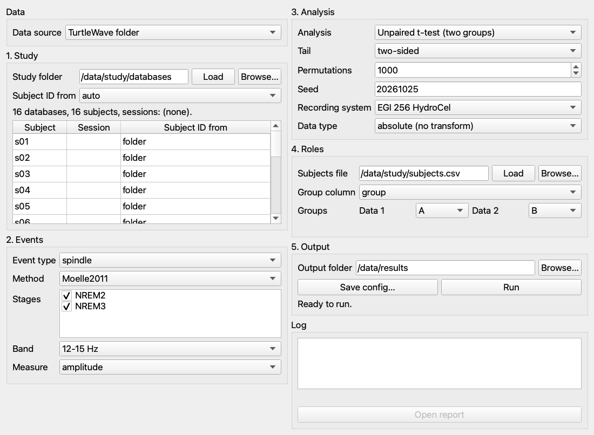
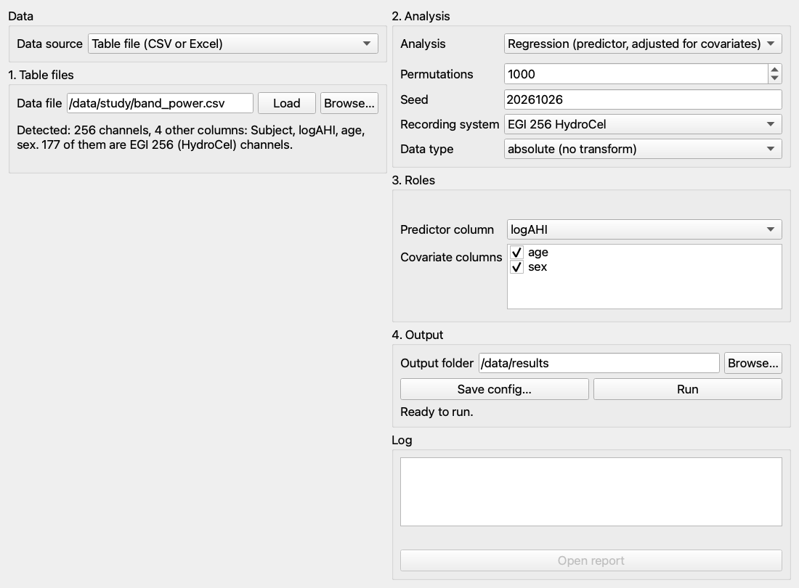

# Use the window (GUI)

The window runs an analysis without writing a configuration file by hand, from either of two
sources, chosen with **Data source** at the top:

- **TurtleWave folder**: a folder of TurtleWave `neural_events.db` files. The window fills in
  the same settings as a `[turtlewave]` section of a `snpm run` configuration file, and every
  check of the request is the one described in
  [Read TurtleWave databases](read-turtlewave-databases.md#run-an-analysis-straight-from-the-databases).
- **Table file (CSV or Excel)**: a table of your own, one row per subject and one column per
  channel (`E1`, `E2`, … or the labels of the recording system), plus a subject column and any
  other columns (group, scores, covariates). The window fills in the settings of an ordinary
  configuration file that names the file, as in [Parameters](../reference/parameters.md).

Either way it runs the settings as `snpm run` does, so a result from the window equals the
result of `snpm run` on the configuration it saves, and a refusal is shown with the same text.

The window offers the paired and unpaired t-tests, the one-way analysis of variance (ANOVA),
the analysis of covariance (ANCOVA), regression and the Pearson and Spearman correlations, and
with a table also the one-sample t-test against zero. The repeated-measures designs (`rmanova`,
`mixed2way`), the mixed linear model and the circular analyses still go through a
configuration file.

## Install and open

The window uses PyQt5, the same toolkit as TurtleWave, so in TurtleWave's environment it is
usually installed already. Otherwise:

    pip install "hdeeg-snpm[gui]"

Open it with either command:

    snpm gui
    snpm-gui

Without PyQt5 both stop with the install command above.

## Fill it in, top to bottom: TurtleWave folder

1. **Study.** Choose the folder that holds the databases with Browse…, or type it and press
   Enter or Load; every `neural_events.db` below it is read. A path typed but not yet read is
   not used, and Run stays greyed out until it is. The line under it says how many databases, subjects and sessions were found, and the
   table lists each database's subject, session and where the subject ID came from. Check it
   by eye. If the subject IDs are wrong, change "Subject ID from" (auto, database or folder
   name; see [which subject a database belongs to](read-turtlewave-databases.md#which-subject-a-database-belongs-to)).
2. **Events.** Event type, method, stages and band list what the databases hold for that event
   type. All stages found are ticked; untick the ones to leave out (at least one must stay
   ticked). A detection run stored without a band shows no band. Measure is amplitude,
   duration, count or density. Density is computed by TurtleWave itself, so it is greyed out
   when TurtleWave is not installed. With density, "Rejected before density" shows the
   annotation types removed from the time density is divided by, as stored by detection
   (for example "Artefact (as detected)"). When the databases store more than one set, choose
   one there instead (the list holds the sets every database stores); see [which artefacts density's time
   excludes](read-turtlewave-databases.md#which-artefacts-densitys-time-excludes).
3. **Analysis.** The analysis, the tail (t-tests only), the number of permutations, the seed,
   the recording system and the data type. When the seed is left empty, the window draws one
   when you press Run or Save config… and shows it in the field, so the saved config repeats
   the run exactly. These are the keys of the same names in [Parameters](../reference/parameters.md).
4. **Roles.** What the analysis needs besides the databases:
   - paired t-test: the two sessions, the first is Data 1;
   - unpaired t-test: a subjects file (a `Subject` column plus one column per variable; type
     the path and press Enter or Load, or use Browse…), its group column and the two groups
     to compare, the first is Data 1. Group labels are compared as written in the file, so
     `01` stays `01`; a subject with an empty group cell is left out and listed in the log;
   - one-way ANOVA: a subjects file and its group column;
   - ANCOVA: a subjects file, its group column and at least one covariate column (tick them);
   - regression: a subjects file, the predictor column (the menu lists only the numeric
     columns of the subjects file) and any covariate columns;
   - correlations: a subjects file and the score column to correlate with;
   - any analysis other than the paired t-test, when the databases come from more than one
     session: the session to analyse.
5. **Output.** The folder for the results.

## Fill it in, top to bottom: table file

1. **Table files.** Choose the file with Browse…, or type its path and press Enter or Load. A
   path typed but not yet read is not used. For an Excel workbook, choose the sheet under
   "Excel sheet"; the first sheet is read until you choose another. The line under the file
   says what was found, for example "Detected: 256 channels, 4 other columns: Subject, logAHI,
   age, sex. 177 of them are EGI 256 (HydroCel) channels." Channels are the columns named like
   `E12`, `Cz` or a label of a supported recording system; only those of the chosen recording
   system are analysed (the EGI montage analyses its 178 scalp channels). The other columns are
   passed on as `meta_cols` and are the ones the role menus offer. The files each analysis
   takes:
   - paired t-test: a condition 1 file and a condition 2 file, with the same subjects in the
     same rows and the same channels in the same order;
   - unpaired t-test: a group 1 file and a group 2 file;
   - one-sample t-test: one data file, tested against zero (for example a file of differences);
   - correlations: a data file and a score file, which is a subject column plus the one score
     to correlate with (or a second channel table); subjects are matched by the subject column;
   - a second file read for one analysis is cleared when you switch to an analysis that reads
     its second file as something else (for example from a paired t-test to a correlation);
   - one-way ANOVA, ANCOVA and regression: one data file holding the channels and the design
     columns.

   Keep the t-test and correlation files to a subject column and channels. Other columns are
   not design columns there, and when they get in the way (a text column, or two files whose
   channels no longer line up) the run stops with the reason.
2. **Analysis.** As for TurtleWave databases, above.
3. **Roles.** The columns of the data file:
   - one-way ANOVA: the group column;
   - ANCOVA: the group column and at least one covariate column;
   - regression: the predictor column (for example `logAHI`) and any covariate columns
     (for example `age` and `sex`). The predictor menu lists only the columns read as
     numbers, because a regression slope needs a numeric predictor; to compare groups such as
     `group`, choose the one-way ANOVA or ANCOVA. A text column such as `sex` is turned into indicator
     columns by the analysis itself. The covariate list leaves out the column chosen as group
     or predictor, and a ticked covariate that becomes the group or predictor is unticked.

   The t-tests and correlations need no roles.
4. **Output.** The folder for the results.

## Run

**Run** stays greyed out until everything above is filled in; the line under it says what is
still missing. The analysis runs in the background, so the window stays responsive, but its
inputs are locked until the run ends. Closing the window during a run does not stop it: the
window stays open until the run has finished and then closes, so no output is left half
written. Warnings and notes (for example subjects left out of the comparison) appear in the log. If the analysis is
refused, a message gives the reason; correct the input and press Run again.

## Where the results go

The output folder gets the four files of any run (results, summary, Excel workbook and HTML
report, described in [Output files](../reference/outputs.md)); a run from TurtleWave databases
also writes a folder ending in `_tables` with the tables built from the databases and
`recordings.csv`. When the run ends,
the window lists the four files, and **Open report** opens the HTML report in the browser.

## Repeat the run from the command line

**Save config…** writes the settings as a TOML file, with the full paths of this computer.
On another computer, such as a computing cluster, edit the paths in the file (`folder` and
`subjects_file`, or `data_file`, `data1_file` and `data2_file`, and `output_path`) to where the
data are there. Run it with:

    snpm run saved.toml

With the same seed the results are identical to the window's.
